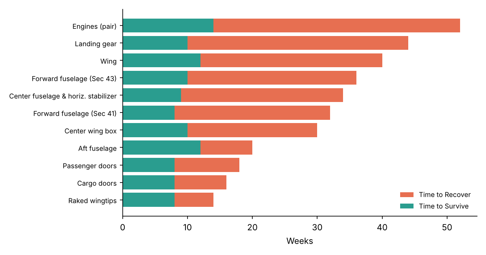
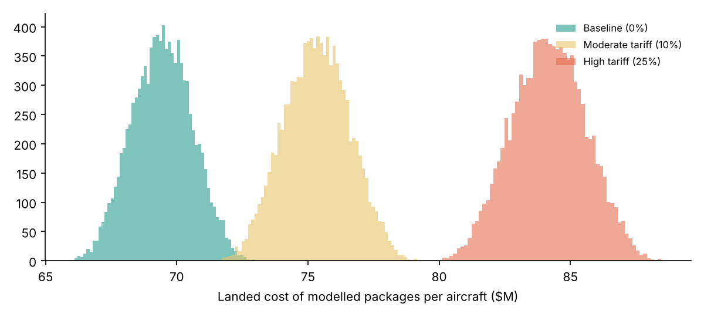

# Boeing 787 Supply Chain — Risk & Tariff Scenario Model


Analytical model for the **Boeing 787 Dreamliner** global supply chain, built for **EMGT 6920 – Logistics Engineering and Management** (UNC Charlotte, Fall 2026). It combines three methods to answer: *Which suppliers can stop the line, which failures matter most, and what do tariffs do to landed cost?*

| Method | Question it answers |
|---|---|
| **TTR/TTS exposure index** | If a supplier is disrupted, does its Time-to-Recover exceed the line's Time-to-Survive? How big is the gap? |
| **FMEA (RPN)** | Which failure modes rank highest on Severity × Occurrence × Detection and need action? |
| **Monte Carlo landed cost** | How does per-aircraft landed cost shift under 0% / 10% / 25% tariff scenarios, including lead-time uncertainty? |

> ⚠️ **Data disclaimer:** work-package/supplier mapping reflects publicly reported 787 partners, but every number in `data/` (costs, lead times, TTR/TTS, FMEA scores) is an **illustrative assumption** for coursework — not Boeing or supplier data. Replace them with your own estimates and cite your sources.

## Quick start

**Easiest:** install the requirements, then run `python main.py`. It runs the whole project and prints where the results are.

Step by step:

```bash
python -m venv .venv && source .venv/bin/activate
pip install -r requirements.txt
PYTHONPATH=src python -m scrisk.run_analysis     # writes reports/analysis.md + charts
pytest
```

## Sample findings (with the illustrative inputs)

- **Highest exposure:** landing gear, engines and the wing — long recovery times, single or constrained sourcing.
- **Top FMEA risk:** supplier quality escape on the forward fuselage (RPN 240).
- **Tariffs:** a 25% tariff on imported packages adds roughly **$14.7M per aircraft** to the modelled packages' mean landed cost; engines and wings drive most of it.




## Model notes

- Exposure gap = max(0, TTR − TTS); single-source packages get a 1.5× multiplier.
- FMEA action rule: RPN ≥ 150 **or** Severity ≥ 9.
- Monte Carlo: 10,000 runs; unit cost ±8% and freight ±25% (triangular), lead time ~ Normal(mean, sd); each week late adds a carrying/disruption penalty (configurable in `Settings`).
- TTR/TTS framing follows Simchi-Levi, Schmidt & Wei, *"From Superstorms to Factory Fires"*, Harvard Business Review (2014).

## Project structure

```
supply-chain-risk-787/
├── data/
│   ├── suppliers.csv           # work packages, lead times, TTR/TTS, tariff exposure (illustrative)
│   └── fmea.csv                # failure modes with S/O/D scores (illustrative)
├── src/scrisk/
│   ├── exposure.py             # TTR/TTS exposure index
│   ├── fmea.py                 # RPN calculation + action rule
│   ├── landed_cost.py          # Monte Carlo tariff scenarios
│   └── run_analysis.py         # runs everything -> reports/
├── reports/                    # analysis.md + charts
├── tests/test_scrisk.py
└── .github/workflows/tests.yml
```

## Team

Course team project — add your teammates' names and GitHub handles here.

## Tech

Python · pandas · NumPy · matplotlib · pytest · GitHub Actions
